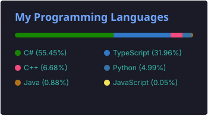

<h1 align="center">Olá, eu sou o Bruno Diniz! 👋</h1>

  <strong>Desenvolvedor Backend | Estudante de BTI na UFRN (IMD) | Data & Analytics | Futuro Arquiteto de Software</strong>

  📍 Natal-RN, Brasil • 💼 Estagiário de Desenvolvimento no <strong>DETRAN</strong> • 🥉 <strong>3º Lugar</strong> no Hackathon de Data Science do IEEE

---

### 👨‍💻 Sobre Mim

Sou estudante do **Bacharelado em Tecnologia da Informação (BTI)** no **IMD/UFRN** e atuo como **Estagiário no DETRAN**, trabalhando diretamente no desenvolvimento e na sustentação de sistemas críticos de trânsito e habilitação, sempre com foco em performance, confiabilidade e arquiteturas robustas para o backend.

🎯 **Objetivo para o futuro:** Meu grande objetivo profissional é me tornar **Arquiteto de Software**. Para construir essa base sólida, dedico meus estudos a **Domain-Driven Design (DDD)**, **Clean Architecture**, estruturação de **Monólitos Modulares**, padrões de projeto, bancos de dados relacionais/NoSQL e cultura **Cloud & DevOps**.

No dia a dia, divido minha rotina entre o desenvolvimento de APIs em **.NET** com **SQL Server / PostgreSQL**, projetos full stack com **TypeScript / Next.js**, estudos acadêmicos em **C++**, **Java** e **Redes**, além de análise de dados e Machine Learning com **Python** em ambiente **Linux (Pop!_OS)**.

---

### 🏆 Experiência & Destaques

- 🏛️ **Estagiário de Desenvolvimento — DETRAN:** Atuação no desenvolvimento, manutenção e evolução de sistemas críticos de trânsito e habilitação, lidando com regras de negócio complexas, integrações e bancos de dados de alta demanda com **.NET** e **SQL Server**.
- 🥉 **3º Lugar no Hackathon de Data Science do IEEE:** Premiação em competição de Ciência de Dados aplicando análise exploratória, modelagem e resolução de problemas reais orientados a dados.
- 🎓 **Tecnologia da Informação — IMD/UFRN:** Forte base acadêmica em Engenharia de Software, Programação Orientada a Objetos (**C++** e **Java**), Estruturas de Dados, Redes de Computadores e Aprendizado de Máquina (**Python**).

---

### 🚀 O que estou construindo & Projetos em Destaque

- 🛡️ **Taverna Web ([Backend](https://github.com/Taverna-Web/taverna-web-backend) | [Frontend](https://github.com/Taverna-Web/taverna-web-frontend)):** Um VTT (*Virtual Tabletop*) para RPG de mesa com painel do mestre, mapas táticos de batalha em tempo real, rolagens de dados sincronizadas, gerenciamento de fichas e integração com o Spotify. Desenvolvido com backend em **.NET 10 (C#), SignalR, YARP Gateway, EF Core, PostgreSQL e Redis**, e frontend em **Next.js (TypeScript)**.
- 🔥 **Checkpoint ([Backend](https://github.com/Checkpoint-site/Checkpoint-backend) | [Frontend](https://github.com/Checkpoint-site/Checkpoint-frontend)):** Ecossistema web estruturado em arquitetura moderna com backend em **C# / .NET** e frontend em **TypeScript**.
- 🛒 **[Super Mercado (C++ & PostgreSQL)](https://github.com/Diniz-Bruno/Super_Mercado):** Sistema completo de gestão de supermercado desenvolvido em **C++**, automatizando controle de estoque, fluxo de carrinho de compras, regras de desconto e relatórios financeiros com banco de dados **PostgreSQL** containerizado via **Docker**.
- 📊 **[Segmentação RFM & Machine Learning](https://github.com/Diniz-Bruno/Projeto_RFM_conjunto_com_machine):** Aplicação de técnicas de aprendizado não-supervisionado (**K-Means, DBSCAN, Clusterização Hierárquica e Análise de Embeddings**) em **Python** para resolução de problemas reais de negócio.
- 🏫 **[Sistema Escolar](https://github.com/Diniz-Bruno/Sistema.Escolar):** Laboratório prático de Programação Orientada a Objetos avançada em **Java**, focado em padrões de projeto (Delegação e Encapsulamento) e gerenciamento eficiente de memória.

---

### 🛠️ Minha Stack de Batalha

**Backend & Linguagens**  
      
*Práticas & Arquitetura:* Clean Architecture, Domain-Driven Design (DDD), Monólitos Modulares, POO Avançada, Redes (TCP/IP, IPv6).

**Bancos de Dados & Mensageria/Cache**  
  

**Frontend**  
       
*Práticas:* Feature-Sliced Design (FSD).

**Ferramentas, DevOps & Infra**  
   

---

### 📈 GitHub Stats

  
  

